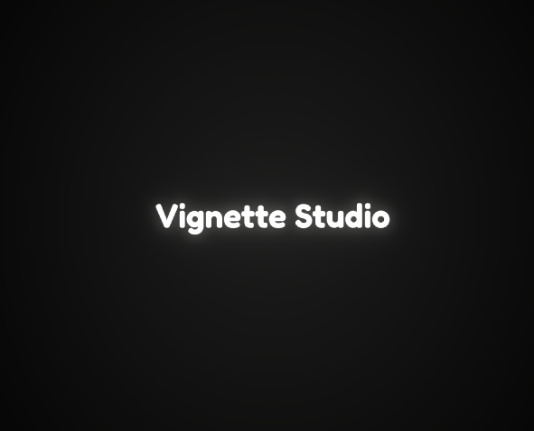

<!DOCTYPE html>
<html>
<head>
<meta charset="UTF-8">
<meta name="viewport" content="width=device-width, initial-scale=1.0">
<title>Vignette Studio - Projects</title>

</head>
<body>

    

        <a id="btn-ko" class="btn active" onclick="showLang('ko')">한국어</a>
        <a id="btn-en" class="btn" onclick="showLang('en')">English</a>
        <a id="btn-ja" class="btn" onclick="showLang('ja')">日本語</a>
        <a id="btn-tw" class="btn" onclick="showLang('tw')">繁體中文</a>
        <a id="btn-cn" class="btn" onclick="showLang('cn')">简体中文</a>
        <a id="btn-es" class="btn" onclick="showLang('es')">Español</a>
    

    
<h1>Vignette Studio에 오신 것을 환영합니다</h1>
"작은 장면 하나하나가 모여 기억에 남는 이야기를 만듭니다."

    
    <h2 class="game-header">프로젝트: 블록밤 (Block Bomb) </h2>
    
체스보드 위에서 펼쳐지는 전략적인 폭발! 블록을 배치하고 최고 점수에 도전하세요.

    
    <h2 class="game-header">프로젝트: BlurV</h2>
    
당신의 일상을 더 선명하게, 혹은 더 부드럽게. 진정성 있는 소통을 위한 디지털 엽서와 시크릿 피드를 경험해 보세요.

    
    
이메일 문의: vignettemanager@gmail.com

    
<h1>Welcome to Vignette Studio</h1>
"Small scenes make memorable stories."

    
    <h2 class="game-header">Our Project: Block Bomb </h2>
    
Strategic explosions on a chessboard! Place blocks and challenge your high score.

    
    <h2 class="game-header">Our Project: BlurV</h2>
    
Make your daily life sharper, or softer. Experience digital postcards and secret feeds for authentic communication.

    
    
Contact: vignettemanager@gmail.com

    
<h1>Vignette Studioへようこそ</h1>
「小さなシーンが積み重なり、記憶に残る物語を作ります」

    
    <h2 class="game-header">プロジェクト: Block Bomb (ブロックボム) </h2>
    
チェス盤の上で繰り広げられる戦略的爆発！ハイスコアを目指しましょう。

    
    <h2 class="game-header">プロジェクト: BlurV</h2>
    
あなたの日常をより鮮明に、あるいはより柔らかく。真のコミュニケーションのためのデジタルポストカードとシークレットフィードを体験してください。

    
    
メール: vignettemanager@gmail.com

    
<h1>歡迎來到 Vignette Studio</h1>
「每一個小場景，匯聚成難忘的故事。」

    
    <h2 class="game-header">專案: Block Bomb (方塊炸彈) </h2>
    
棋盤上的策略爆炸！放置方塊並挑戰最高分。

    
    <h2 class="game-header">專案: BlurV</h2>
    
讓您的日常生活更清晰，或更柔和。體驗數位明信片和秘密動態，進行真實的交流。

    
    
郵箱: vignettemanager@gmail.com

    
<h1>欢迎来到 Vignette Studio</h1>
“每一个小场景，汇聚成难忘的故事。”

    
    <h2 class="game-header">项目: Block Bomb (方块炸弹) </h2>
    
棋盘上的策略爆炸！放置方块并挑战最高分。

    
    <h2 class="game-header">项目: BlurV</h2>
    
让您的日常生活更清晰，或更柔和。体验数字明信片和秘密动态，进行真实的交流。

    
    
邮箱: vignettemanager@gmail.com

    
<h1>Bienvenido a Vignette Studio</h1>
"Las pequeñas escenas crean historias memorables."

    
    <h2 class="game-header">Proyecto: Block Bomb </h2>
    
¡Explosiones estratégicas en un tablero de ajedrez! Desafía tu puntuación más alta.

    
    <h2 class="game-header">Proyecto: BlurV</h2>
    
Haz tu vida diaria más nítida o más suave. Experimenta postales digitales y feeds secretos para una comunicación auténtica.

    
    
Email: vignettemanager@gmail.com

</body>
</html>
